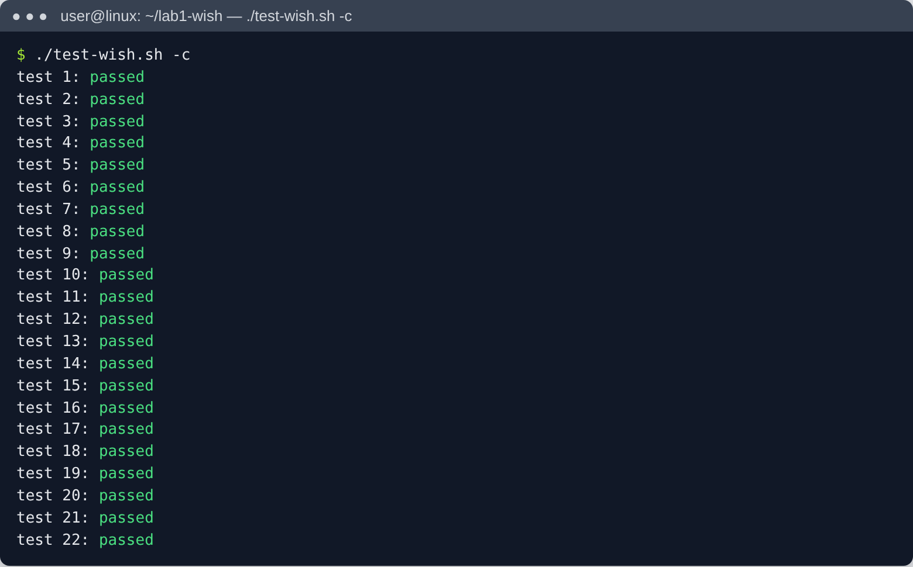
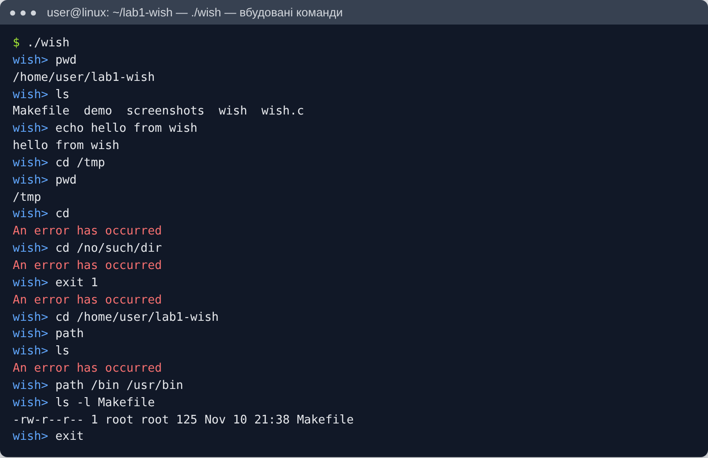
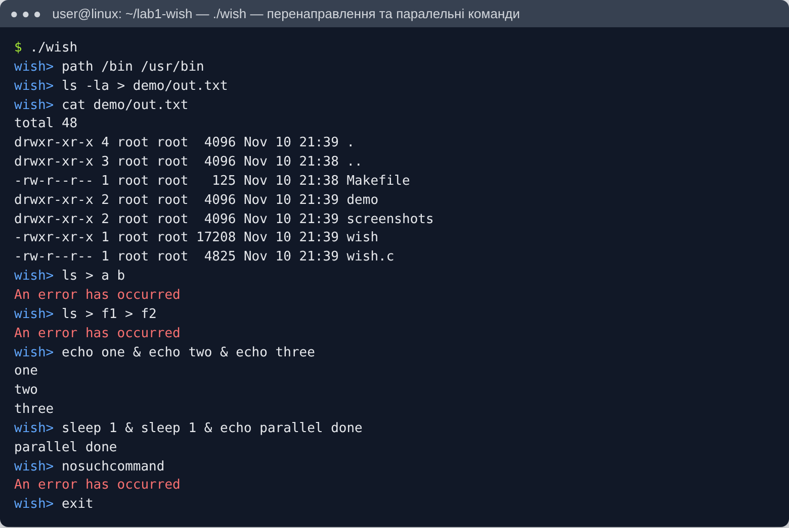
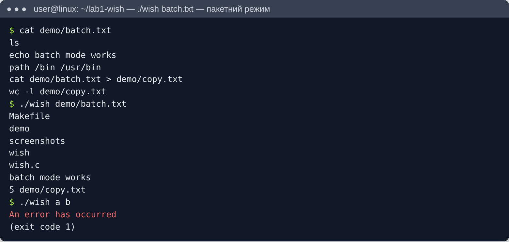

# Програмний проєкт 1 — Unix Shell `wish`

**Виконав:** Микулінський Артем Віталійович, група ТК-41

Реалізація простої командної оболонки `wish` (Wisconsin Shell) за завданням
[OSTEP processes-shell](https://github.com/remzi-arpacidusseau/ostep-projects/blob/master/processes-shell/README.md).

## Можливості

- **Інтерактивний режим** (`./wish`) — виводить запрошення `wish> ` і виконує команди користувача.
- **Пакетний режим** (`./wish batch.txt`) — читає команди з файлу, запрошення не виводить.
- **Вбудовані команди:** `exit`, `cd <dir>`, `path [dir ...]`.
- **Шлях пошуку:** спочатку `/bin`; команда `path` повністю перезаписує список каталогів.
- **Перенаправлення виводу:** `cmd args > file` — stdout і stderr ідуть у файл (файл перезаписується).
- **Паралельні команди:** `cmd1 & cmd2 & cmd3` — усі запускаються одночасно, оболонка чекає завершення всіх.
- **Обробка помилок:** на будь-яку помилку виводиться `An error has occurred` у stderr, оболонка продовжує роботу. Неправильний виклик (більше одного аргументу або файл не відкривається) завершує оболонку з кодом 1.

## Збирання та запуск

```bash
make
./wish              # інтерактивний режим
./wish demo/batch.txt   # пакетний режим
```

## Тестування

Офіційні тести з репозиторію `ostep-projects`:

```bash
git clone https://github.com/remzi-arpacidusseau/ostep-projects
cp wish ostep-projects/processes-shell/
cd ostep-projects/processes-shell && ./test-wish.sh
```

Результат: **усі 22 тести пройдено**.

## Як влаштовано

| Функція | Призначення |
|---|---|
| `main` | вибір режиму (інтерактивний / пакетний), цикл `getline()` |
| `tokenize` | розбиття рядка на токени; `>` та `&` виділяються навіть без пробілів (`ls>out`) |
| `process_line` | ділить рядок за `&` на команди, запускає їх і чекає всі через `waitpid()` |
| `run_command` | перевірка перенаправлення, вбудовані команди, `fork()` + `execv()` |
| `find_exec` | пошук виконуваного файлу в каталогах `path` через `access(..., X_OK)` |

## Скріншоти

| | |
|---|---|
| Збирання |  |
| Тести |  |
| Вбудовані команди та помилки |  |
| Перенаправлення та паралельні команди |  |
| Пакетний режим |  |
